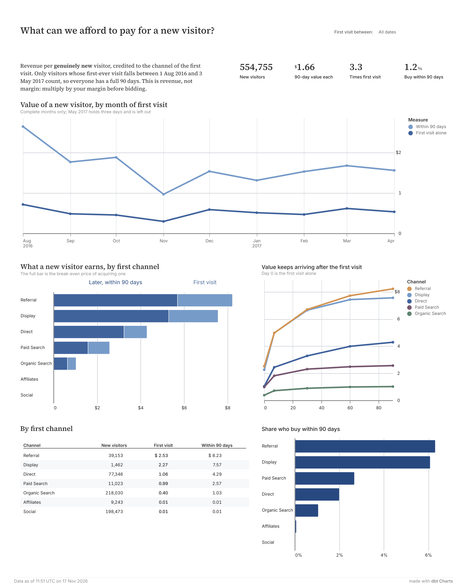

# Agentic analytics workshop

The sample project for a one-hour workshop on doing analytics work with Claude
Code: BigQuery for the data, dbt for the models, and a dashboard built two
ways.

It answers one question on Google's public Google Analytics 360 sample, a year
of real visits to the Google Merchandise Store:
**what can we afford to pay for a new visitor, by marketing channel?**



**Start with [WORKSHOP.md](WORKSHOP.md).** It is the step-by-step guide, with
the prompts to paste and what to expect at each step.

## Quick start

```bash
gcloud auth application-default login
export GCP_PROJECT=your-project-id
uv sync
uv run dbt build     # PASS=19 WARN=0 ERROR=0
uv run dct serve     # the board, in your browser
```

## What is where

| Path | What it is |
|---|---|
| `AGENTS.md` | Project context Claude reads every session: commands, cost rules, business definitions, data quirks |
| `.claude/settings.json` | Which commands run without asking, and which are refused |
| `.claude/skills/add-metric/` | The workshop's own skill: add a metric end to end |
| `.claude/skills/dct/` | The skill dbt Charts installs for itself |
| `.mcp.json` | The dbt Charts MCP server, for step 5.3 |
| `models/staging/` | `stg_sessions`: one row per visit, with split visits merged |
| `models/marts/` | `dim_visitors`, `visitor_value_by_channel`, and `visitor_value_curve` (added in step 8) |
| `charts/channel_value.yml` | The dashboard, as YAML |
| `lightdash/` | The same dashboard for Lightdash (optional step 8): eight charts and one dashboard as YAML |
| `analyses/` | The ad-hoc query from step 2 |

Tested with dbt Core 1.12.7, dbt-bigquery 1.12.3 and dbt Charts 0.11.1 (pinned;
it is pre-1.0).
